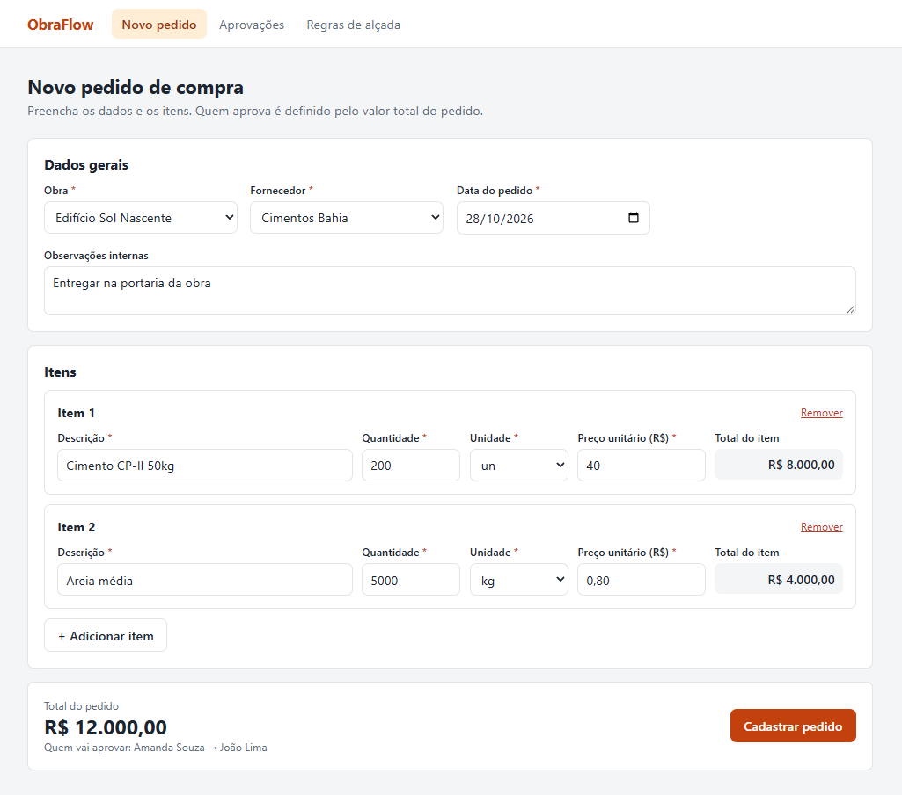
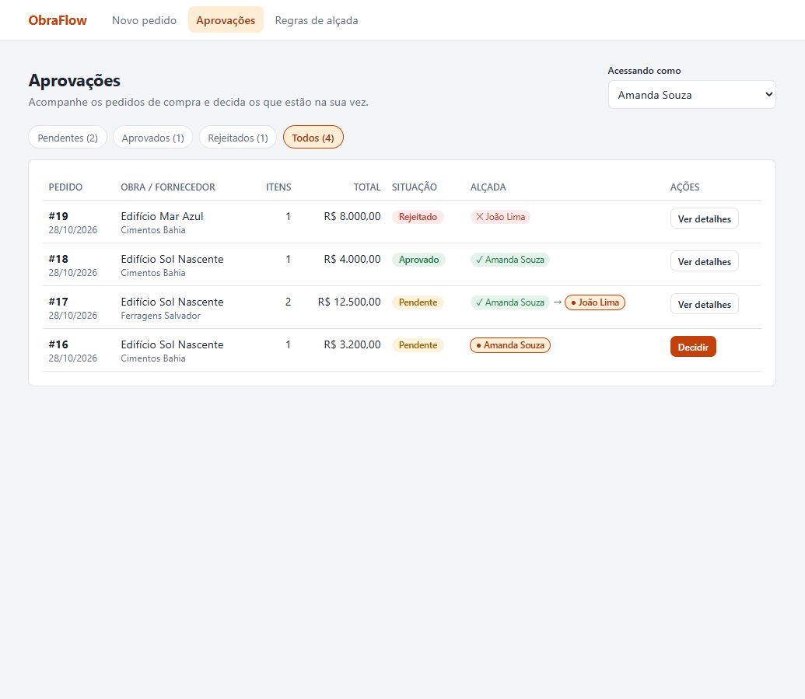
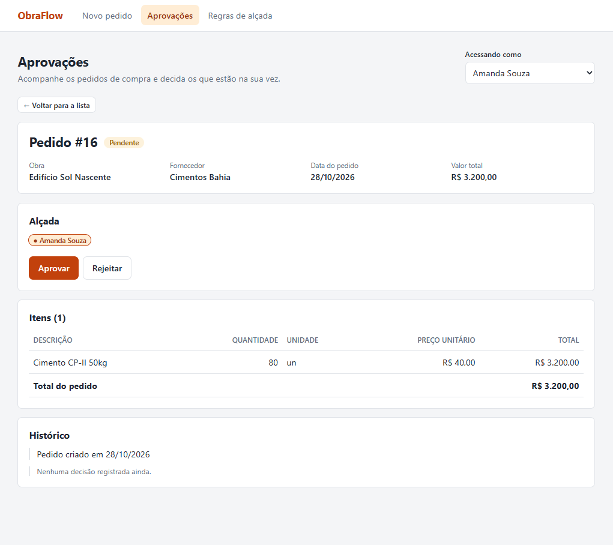
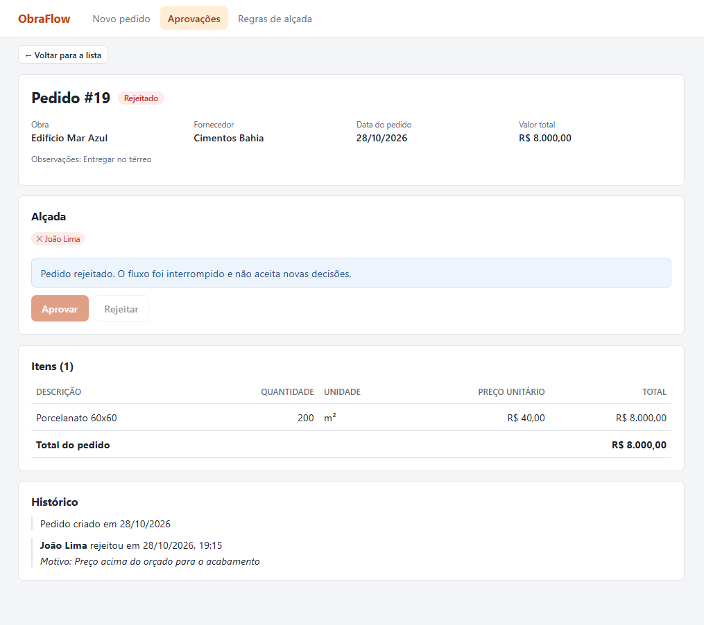
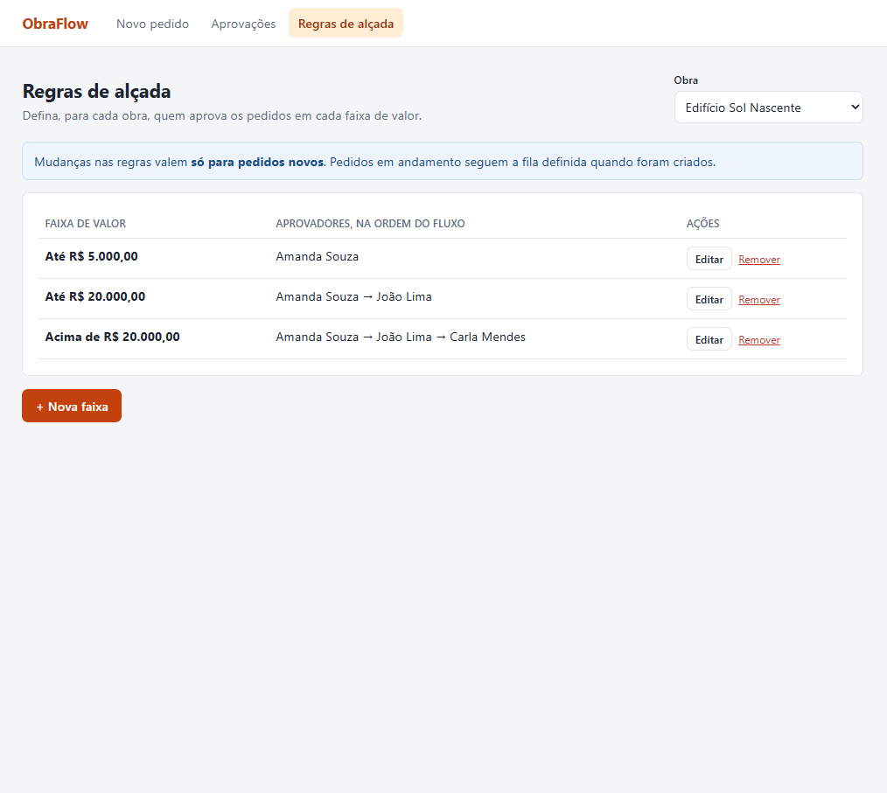
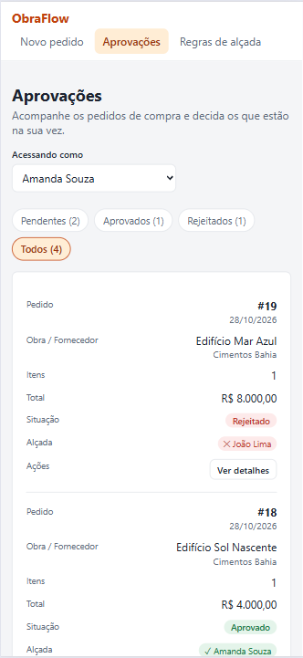
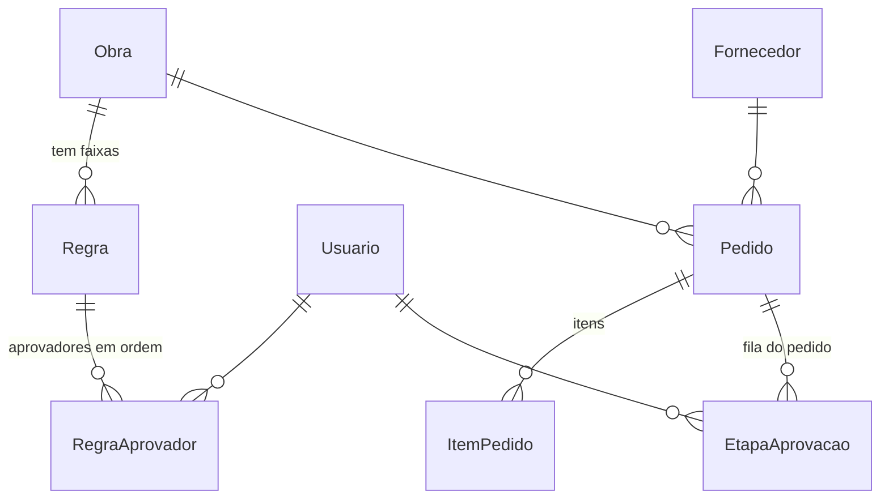

# ObraFlow: pedidos de compra com aprovação por alçada

Solução do desafio full-stack da ObraFlow. O sistema tem três telas: cadastro de pedido de compra, aprovação e configuração das regras de alçada por obra.

O pedido é criado com N itens, o back-end calcula o total, escolhe a faixa de alçada da obra e monta a fila de aprovadores. Cada pessoa decide na sua vez. Se alguém rejeitar, o fluxo para e o motivo fica no histórico.

## Telas

| Novo pedido | Aprovações |
|---|---|
|  |  |

| Detalhes do pedido | Pedido rejeitado |
|---|---|
|  |  |

| Regras de alçada | No celular |
|---|---|
|  |  |

## Como rodar

Precisa só do **Node.js 22 ou superior**. Não tem banco para instalar nem credencial externa: o banco é um arquivo SQLite criado na hora.

### 1. Back-end (porta 1036)

```bash
cd backend
npm install
cp .env.example .env          # no Windows (cmd): copy .env.example .env
npx prisma migrate deploy     # cria o banco e as tabelas
npx prisma generate           # gera o client do Prisma
npm run seed                  # coloca os dados de demonstração
npm run dev
```

### 2. Front-end (porta 5173), em outro terminal

```bash
cd frontend
npm install
npm run dev
```

Depois é só abrir **http://localhost:5173**.

### Comandos úteis (na pasta `backend`)

| Comando | O que faz |
|---|---|
| `npm run seed` | Apaga tudo e volta os dados de demonstração ao estado inicial |
| `npm test` | Roda os testes automatizados |

## Dados de demonstração

**Usuários:** Amanda Souza, João Lima e Carla Mendes. Não tem login: na tela de aprovações, o campo **"Acessando como"** escolhe quem está usando o sistema.

**Regras de alçada:**

| Obra | Faixa | Aprovadores, em ordem |
|---|---|---|
| Edifício Sol Nascente | Até R$ 5.000 | Amanda |
| Edifício Sol Nascente | Até R$ 20.000 | Amanda → João |
| Edifício Sol Nascente | Acima de R$ 20.000 | Amanda → João → Carla |
| Edifício Mar Azul | Até R$ 10.000 | João |
| Edifício Mar Azul | Acima de R$ 10.000 | João → Carla |

**Pedidos**, um em cada situação:

| Pedido | Valor | Situação |
|---|---|---|
| Cimento (Sol Nascente) | R$ 3.200 | Pendente, vez da Amanda |
| Ferragens (Sol Nascente) | R$ 12.500 | Pendente, Amanda já aprovou, vez do João |
| Areia (Sol Nascente) | R$ 4.000 | Aprovado |
| Porcelanato (Mar Azul) | R$ 8.000 | Rejeitado pelo João, com motivo |

## API

API REST em JSON. Valores em dinheiro vão e voltam **em centavos** (`120000` = R$ 1.200,00).

| Método | Rota | Corpo | O que faz |
|---|---|---|---|
| GET | `/obras` | | Lista as obras |
| POST | `/obras` | `{ "nome": "Residencial Teste" }` | Cadastra uma obra |
| GET | `/usuarios` | | Lista os usuários |
| POST | `/usuarios` | `{ "nome": "Ana", "email": "ana@example.com" }` | Cadastra um usuário |
| GET | `/fornecedores` | | Lista os fornecedores |
| POST | `/fornecedores` | `{ "nome": "Loja X", "cnpj": "12345678000190" }` | Cadastra um fornecedor |
| GET | `/pedidos` | | Lista os pedidos com obra, fornecedor, fila e quantidade de itens |
| GET | `/pedidos/:id` | | Detalhes do pedido com itens e histórico |
| POST | `/pedidos` | ver abaixo | Cria o pedido e a fila de aprovação |
| POST | `/pedidos/:id/aprovar` | `{ "idUsuario": 1 }` | Aprova, se for a vez desse usuário |
| POST | `/pedidos/:id/rejeitar` | `{ "idUsuario": 1, "motivo": "..." }` | Rejeita, com motivo obrigatório |
| GET | `/obras/:id/regras` | | Lista as faixas da obra, em ordem de valor |
| PUT | `/obras/:id/regras` | ver abaixo | Substitui todas as faixas da obra |

**Criar pedido:**

```json
{
  "idObra": 1,
  "idFornecedor": 1,
  "dataPedido": "2026-10-28",
  "observacoes": "Entregar na portaria da obra",
  "itens": [
    { "descricao": "Cimento CP-II 50kg", "quantidade": 200, "unidade": "un", "precoUnitarioCentavos": 4000 }
  ]
}
```

Unidades aceitas: `un`, `kg`, `m`, `m²` e `h`. O total do item e do pedido **não são enviados**: o back-end calcula.

**Salvar regras de uma obra** (`valorMaximoCentavos: null` é a faixa sem teto; `aprovadores` são ids de usuário, já na ordem do fluxo):

```json
{
  "faixas": [
    { "valorMaximoCentavos": 1000000, "aprovadores": [2] },
    { "valorMaximoCentavos": null, "aprovadores": [2, 3] }
  ]
}
```

**Erros:** regra de negócio volta `400` com `{ "erro": "mensagem" }`, recurso inexistente volta `404` e falha inesperada volta `500`.

## Decisões técnicas

### Tecnologias

| Camada | Escolha | Por quê |
|---|---|---|
| Linguagem | TypeScript nos dois lados | Uma linguagem só no projeto inteiro, e os tipos pegam erros enquanto escrevo, não em produção |
| Back-end | Node.js + Express | Simples, direto e muito usado. Para uma API desse tamanho, um framework maior seria exagero |
| Banco | SQLite | É um arquivo só: quem baixa o projeto roda sem instalar servidor de banco nem criar usuário e senha |
| ORM | Prisma 7 | O schema vira as tabelas pelas migrations, e as consultas são tipadas (o TypeScript avisa se eu errar um campo) |
| Front-end | React + Vite | Componentes reaproveitáveis (estados de carregamento, erro e vazio, a fila de aprovação) e um ambiente de desenvolvimento rápido |
| Estilo | CSS puro com variáveis | Para três telas, não precisava de biblioteca. As cores ficam todas num lugar só |
| Testes | Vitest | Funciona direto com TypeScript, sem configuração |

### Como a alçada é modelada



- **Regra** é uma faixa de valor de uma obra. `valorMaximoCentavos` é o teto; vazio (`null`) quer dizer **sem teto**
- **RegraAprovador** liga a faixa aos usuários, com a `ordem` de cada um
- **EtapaAprovacao** é a fila **do pedido**. Quando o pedido é criado, os aprovadores da faixa são **copiados** para cá
- **Pedido.etapaAtual** guarda em qual etapa da fila o pedido está

A decisão mais importante foi essa cópia. A regra é o modelo, e a fila do pedido é uma fotografia dela no momento da criação. Se alguém mudar a regra depois, os pedidos em andamento continuam com quem era responsável na época. Isso também serve de histórico: as etapas já decididas guardam quem decidiu, quando e, na rejeição, o motivo.

Cada faixa guarda a **lista completa** de aprovadores (ex.: "Acima de R$ 20.000 → Amanda → João → Carla"), em vez de somar as faixas de baixo. Assim a regra fica explícita e cada obra pode montar a fila que quiser.

### Como a alçada é calculada

1. O back-end soma os itens (quantidade × preço) e chega ao total do pedido
2. Escolhe a **menor faixa em que o total cabe**. O valor igual ao teto ainda cabe na faixa, e a faixa sem teto só é usada se nenhuma outra servir
3. Copia os aprovadores da faixa para a fila do pedido, com `etapaAtual = 1`
4. A cada decisão:
   - **Rejeitou:** o pedido fica `REJEITADO` na hora
   - **Aprovou e era o último:** o pedido fica `APROVADO`
   - **Aprovou e tem mais gente:** a vez passa para a próxima etapa

**Valor sem regra aplicável:** se nenhuma faixa da obra cobre o total, **o pedido não é criado** e a API responde com uma mensagem clara. A tela de novo pedido já avisa isso antes do envio, e a tela de regras mostra um alerta quando a obra não tem faixa sem teto.

### Como é persistida

- O pedido é criado **junto** com os itens e a fila numa única operação: ou grava tudo, ou nada
- O status e a etapa atual ficam salvos no pedido. A tela só mostra o que o back-end calculou
- Dinheiro é guardado em **centavos, como número inteiro**, para evitar erro de arredondamento com casas decimais

### Como o front conversa com o back

O front chama a API REST com `fetch`, sempre pelo mesmo arquivo (`frontend/src/api.ts`). Ele trata os dois tipos de erro num lugar só: se a API estiver fora do ar, aparece uma tela de erro com o botão **Tentar novamente**; se a regra de negócio recusar algo, aparece a mensagem que veio do back.

Como o front (porta 5173) e o back (porta 1036) rodam em endereços diferentes, o navegador bloquearia as chamadas por segurança. Por isso o back libera o acesso do front com **CORS**.

### Como a consistência e a integridade são garantidas

- **Quem decide é o back-end.** O front calcula o total e mostra quem vai aprovar só como prévia; o valor oficial, a faixa e a ordem são decididos no servidor
- **Validação dos dois lados.** O front valida para dar retorno rápido, e o back valida de novo, porque a API pode ser chamada sem passar pela tela
- **Restrições no banco:** chaves estrangeiras, e-mail e CNPJ que não se repetem, e a mesma faixa ou a mesma fila não pode ter duas pessoas com a mesma ordem
- **Decisão em transação:** a etapa e o pedido são atualizados juntos. A etapa só é gravada se ainda estiver `AGUARDANDO`, então duas decisões ao mesmo tempo no mesmo pedido não passam
- **Ordem da fila:** só o usuário da etapa atual pode decidir, e pedido concluído não aceita nova decisão
- **Regras:** antes de salvar, o back confere que todo teto é maior que zero e não se repete, que existe no máximo uma faixa sem teto e que toda faixa tem pelo menos um aprovador, sem repetir pessoa. As faixas da obra são trocadas numa transação

### Decisões de produto

- Na lista, o botão é **"Decidir"** e abre os detalhes, em vez de aprovar direto na lista. Quem aprova precisa ver os itens antes de decidir
- A lista mostra a fila com ✓ para quem aprovou, ● para quem é a vez e ○ para quem vem depois
- Os erros dos campos só aparecem depois que a pessoa passa pelo campo, para não abrir a tela cheia de vermelho. O link **"Ver o que falta preencher"** mostra tudo de uma vez
- No celular, cada linha da lista de pedidos vira um cartão

### Testes

`npm test` (na pasta `backend`) roda 16 testes automatizados: a escolha da faixa, o avanço da fila depois de cada decisão e as validações do pedido. O roteiro de testes manuais está em [docs/testes-manuais.md](docs/testes-manuais.md).

### O que eu mudaria em produção

- **Login e permissões:** o "Acessando como" vira o usuário logado, e só quem tem permissão edita as regras
- **PostgreSQL** no lugar do SQLite, para aguentar muitos acessos ao mesmo tempo. Com o Prisma, a troca é pequena
- **Versionar as regras** em vez de apagar e recriar, para ter histórico de quem mudou o quê e quando
- **Notificar o aprovador da vez** por e-mail ou dentro do sistema
- **Paginação e filtros no back-end**, porque a lista de pedidos vai crescer
- **Mais testes:** das rotas da API e das telas
- **Facilitar a instalação**, para o projeto subir com um comando só, sem precisar rodar cada passo na mão

## Estrutura

```
backend/
  prisma/schema.prisma     modelagem do banco
  prisma/migrations/       SQL gerado a partir do schema
  src/server.ts            rotas da API
  src/services/alcada.ts   escolha da faixa e avanço da fila
  src/services/pedidos.ts  criar pedido, aprovar e rejeitar
  src/services/regras.ts   listar e salvar as regras
  src/seed.ts              dados de demonstração
frontend/
  src/paginas/             as três telas
  src/componentes/         fila de aprovação, detalhes do pedido e estados
  src/api.ts               comunicação com o back-end
```